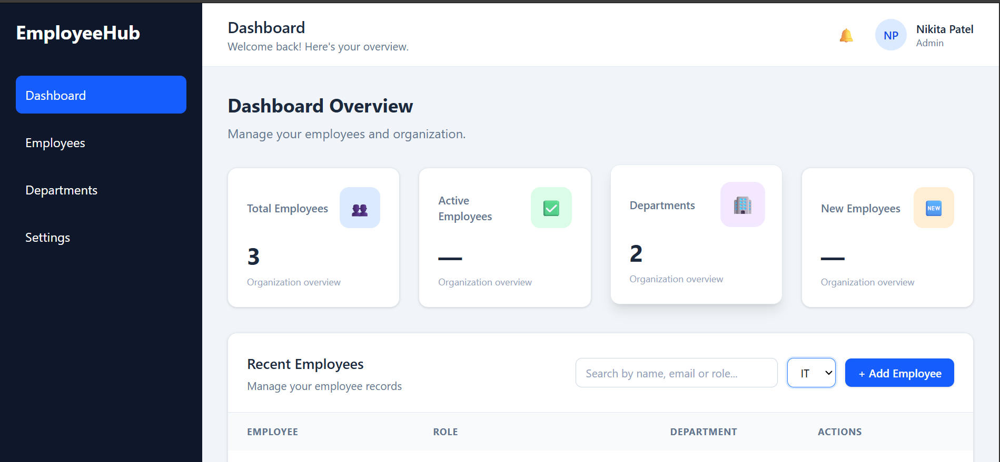
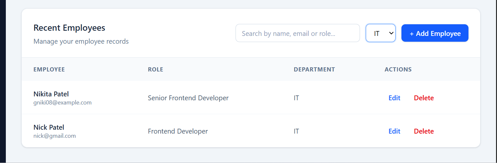
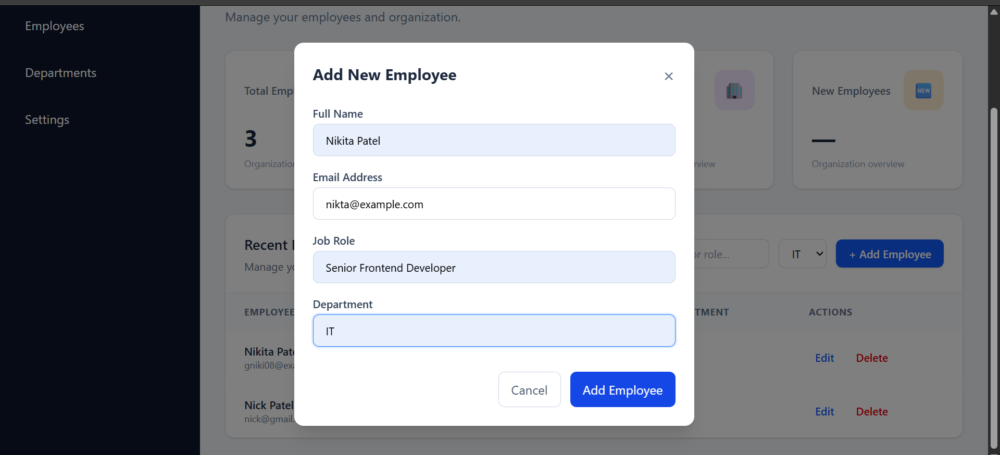
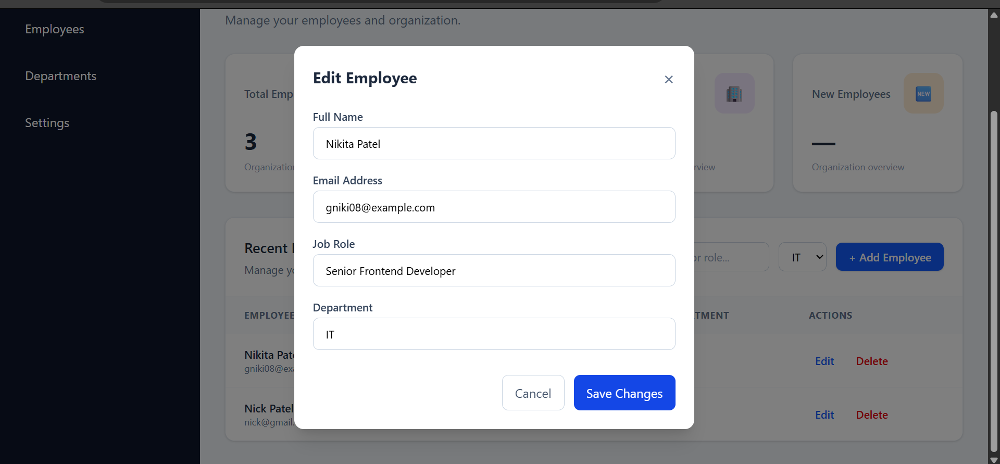
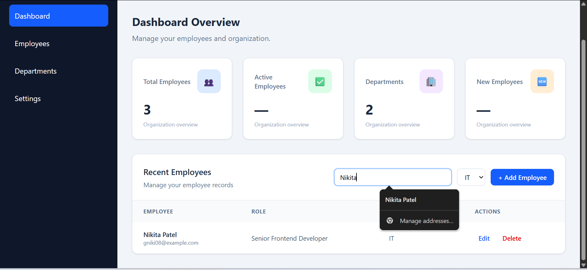
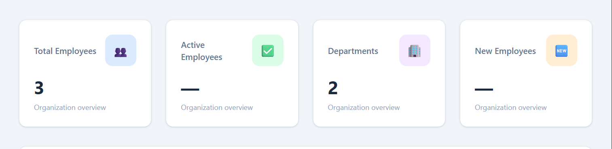

# Admin & Employee Management Dashboard

A full-stack Admin & Employee Management Dashboard built with React, TypeScript, Redux Toolkit, Node.js, Express.js, and PostgreSQL. Includes employee CRUD operations, dashboard analytics, search, filtering, and responsive UI.

## Project Overview

The application allows administrators to manage employee information, view dashboard statistics, search employee records, and filter employees by department.

## Live Demo

- **Frontend:** https://frontend-fullstack-portfolio-omega.vercel.app
- **Backend:** https://frontend-fullstack-portfolio.onrender.com

## Key Features

- Employee CRUD operations (Create, Read, Update, Delete)
- Dashboard with employee and department statistics
- Search employees by name, email, or role
- Filter employees by department
- Centralized state management using Redux Toolkit
- REST API integration
- Loading, error, and empty states
- Responsive design for different screen sizes

## Tech Stack

### Frontend
- React.js
- TypeScript
- Redux Toolkit
- React Redux
- Tailwind CSS
- Axios
- Vite

### Backend
- Node.js
- Express.js
- REST API
- PostgreSQL
- pg (PostgreSQL client)
- dotenv
- CORS

### Database
- Neon PostgreSQL

### Deployment
- Vercel — Frontend
- Render — Backend
- Neon — Database

## Project Structure

```text
01-admin-employee-dashboard/
│
├── backend/
│   ├── src/
│   │   ├── config/
│   │   │   └── database.js
│   │   ├── controllers/
│   │   ├── routes/
│   │   ├── middleware/
│   │   ├── services/
│   │   ├── validators/
│   │   └── server.js
│   ├── package.json
│   └── .gitignore
│
├── frontend/
│   ├── src/
│   │   ├── app/
│   │   │   └── store.ts
│   │   ├── components/
│   │   │   ├── dashboard/
│   │   │   ├── employees/
│   │   │   └── layout/
│   │   ├── features/
│   │   │   └── employees/
│   │   ├── pages/
│   │   └── services/
│   └── package.json
│
└── README.md
```

## Application Screenshots

### Dashboard


### Employee Management


### Add Employee


### Edit Employee


### Search and Filter


### Dashboard Statistics
